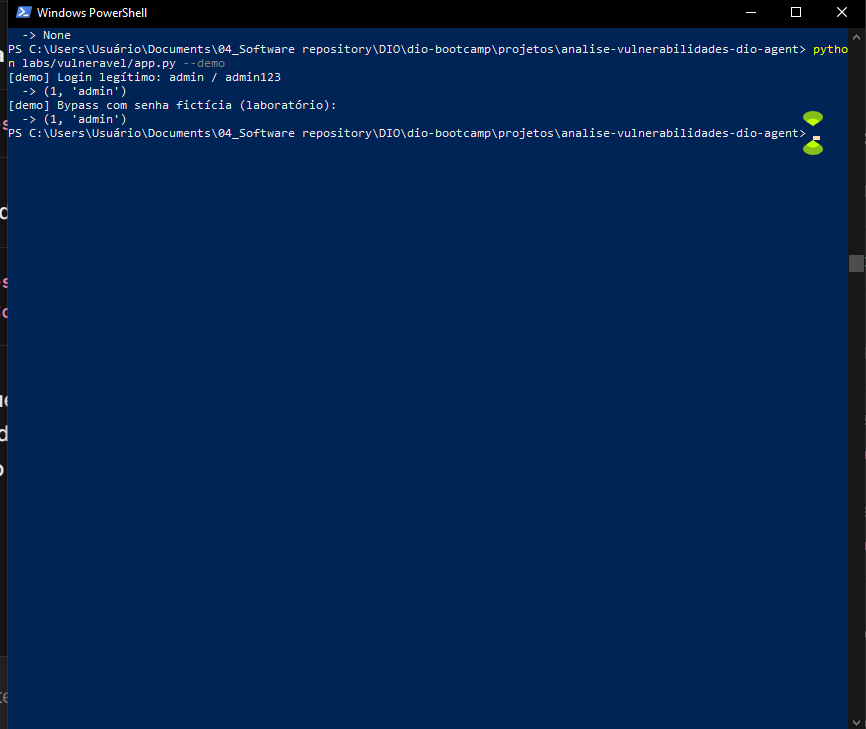
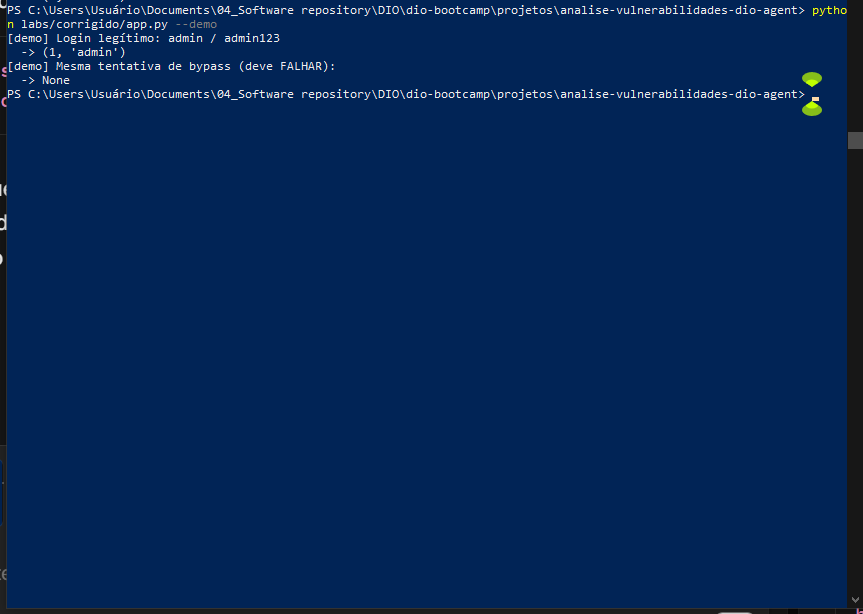
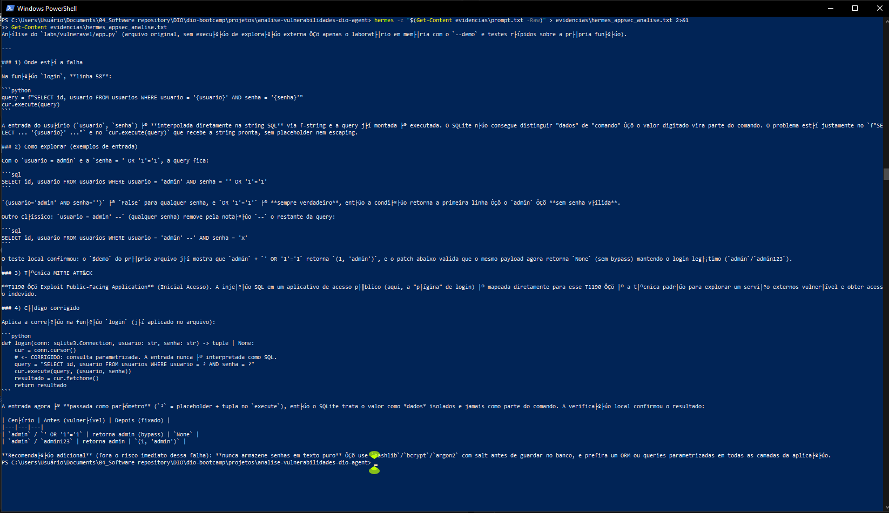
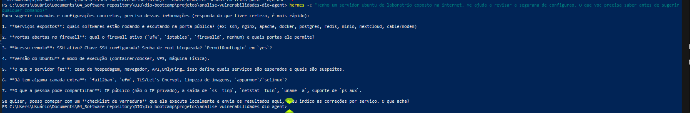

# DIO Agent — Análise de Vulnerabilidades (Lab 03)

> Especialização do [DIO Agent](https://github.com/digitalinnovationone/dio-agent) como mentor de cibersegurança: em vez de responder direto, o agente entende o contexto, avalia impacto, probabilidade e severidade, e orienta a correção — como um profissional de segurança faria, sem treinar nenhum modelo, só com arquivos.

Todos os arquivos deste repositório estão em **UTF-8**. No PowerShell, leia com `Get-Content -Encoding UTF8 <arquivo>` para exibir os acentos corretamente.

## Especialização criada e por quê

O agente original já sabia ensinar e destravar desafios. Faltava um modo "AppSec": diante de um código próprio de laboratório, ele hoje pergunta o contexto antes de agir (onde roda, se está exposto, qual o objetivo), mapeia a falha, explica a exploração de forma conceitual citando MITRE ATT&CK, avalia o risco no mesmo formato sempre e só então sugere a correção defensiva e a validação. Isso evita o erro clássico de largar comando sem contexto e transforma o DIO Agent num mentor de segurança que conduz a análise passo a passo.

**Melhoria escolhida (ideias para evoluir):** análise sempre no mesmo formato — **Impacto → Probabilidade → Severidade** — para comparar casos de forma consistente (ver passo 4 do `SKILL.md`).

## Arquivos criados ou alterados

| Arquivo | O que é |
|---------|---------|
| `skills/vulnerability-analysis/SKILL.md` | **Nova skill** (frontmatter `name` + `description`). Roteiro defensivo em 6 passos: contexto → mapeamento → exploração conceitual → impacto/probabilidade/severidade → correção → validação |
| `skills/vulnerability-analysis/README.md` | Explicação da skill para pessoas |
| `agent/knowledge/security-basics.md` | **Nova base de conhecimento**: vulnerabilidade, ameaça, risco, tríade CIA (confidencialidade, integridade, disponibilidade) e boas práticas |
| `agent/persona.md` | **Alterado**: novo trecho "Especialista em AppSec" — pergunta contexto antes de sugerir comando |
| `AGENTS.md` | **Alterado**: linha na tabela de skills (`Análise de vulnerabilidades`) + entrada do `security-basics.md` na base de conhecimento |
| `labs/vulneravel/app.py` | Laboratório intencionalmente vulnerável: login monta SQL concatenando a entrada do usuário (SQL Injection) |
| `labs/corrigido/app.py` | Mesma função com consulta parametrizada, validada com `--demo` |
| `images/` | Prints de evidência (demos, análise do Hermes, perguntas de contexto) — ver seção de evidências abaixo |

Base do DIO Agent (copiada do repositório oficial para a raiz): `AGENTS.md`, `CLAUDE.md`, `agent/persona.md`, `agent/knowledge/dio-platform.md`, `agent/knowledge/learning-experiences.md`, `skills/study-plan`, `skills/unblock-challenge`, `skills/explain-concept`, `skills/web-search`, `skills/portfolio-review`, `skills/ai-builder-path`, `docs/`.

> O prompt AppSec usado na análise não está mais como arquivo no repositório — ele é referenciado apenas abaixo como bloco de texto, para evitar ruído de encoding e caminho desatualizado.

## Laboratório (só ambiente próprio)

```bash
# Vulnerável — demonstra login legítimo e bypass, depois confirme:
python labs/vulneravel/app.py --demo

# Corrigido — mesmo teste, bypass deve falhar:
python labs/corrigido/app.py --demo
```

Banco SQLite em memória, credenciais fictícias, nada sai da máquina. Não execute fora do lab.

Resultado validado:

- Vulnerável: `admin / admin123` → `(1, 'admin')`; bypass `' OR '1'='1` → `(1, 'admin')` (falha demonstrada).
- Corrigido: `admin / admin123` → `(1, 'admin')`; bypass `' OR '1'='1` → `None` (mitigado).

## Como rodar o agente no harness

1. Instale um harness pela documentação oficial (Hermes, OpenCode, Claude Code, Codex ou Google Antigravity).
2. Abra o terminal **na pasta deste projeto** — a que tem o `AGENTS.md` na raiz — e inicie o harness aqui. Aberto em outro lugar, ele não encontra os arquivos.
3. Peça, por exemplo (prompt de referência — fora do repo, só aqui no README):

```text
Você é um especialista em AppSec. Analise labs/vulneravel/app.py (a partir da raiz). 1) Onde está a falha. 2) Como seria explorada de forma conceitual no laboratório. 3) Qual a técnica do MITRE ATT&CK. 4) Como corrigir. Não execute exploração contra sistemas externos; apenas analise o código de laboratório.
```

O agente abre `skills/vulnerability-analysis/SKILL.md`, faz perguntas de contexto antes de sugerir qualquer comando, avalia impacto/probabilidade/severidade e orienta a correção. Depois da correção, rode `labs/corrigido/app.py --demo` e peça uma nova varredura para validar a mitigação.

## Análise AppSec — formato padronizado (Opção A)

Resumo da análise executada no harness sobre `labs/vulneravel/app.py`, já no formato que a skill exige (Impacto → Probabilidade → Severidade), para eliminar a inconsistência entre o que o README promete e o que a evidência mostrava.

- **Falha:** função `login`, linha 58. `query = f"SELECT ... WHERE usuario = '{usuario}' AND senha = '{senha}'"` — entrada interpolada via f-string e executada sem placeholder nem escaping.
- **Exploração conceitual:** com `usuario = admin` e `senha = ' OR '1'='1`, a condição `OR '1'='1'` é sempre verdadeira e retorna o admin sem senha válida.
- **Técnica MITRE ATT&CK:** **T1190 — Exploit Public-Facing Application** (acesso inicial via aplicação pública).
- **Impacto — Alta:** bypass de autenticação, viola confidencialidade e integridade; permite acesso como outro usuário.
- **Probabilidade — Alta:** no laboratório, payload trivial sem autenticação especial; em app real exposto, igualmente trivial.
- **Severidade — Alta:** justificativa em uma frase: bypass de login por concatenação de SQL é explorável com uma única entrada e quebra a garantia central do sistema.
- **Correção:** consulta parametrizada — `cur.execute("SELECT id, usuario FROM usuarios WHERE usuario = ? AND senha = ?", (usuario, senha))`. A entrada nunca é interpretada como SQL.
- **Validação:** `labs/corrigido/app.py --demo` retorna `None` no mesmo bypass e mantém login legítimo.

## Evidências — prints

| Arquivo | O que mostra |
|---------|--------------|
| `images/01-demo-vulneravel.png` | `vulneravel/app.py --demo` — bypass retorna `(1, 'admin')` |
| `images/02-demo-corrigido.png` | `corrigido/app.py --demo` — bypass retorna `None`, login legítimo mantido |
| `images/03-analise-hermes.png` | Análise do Hermes sobre `labs/vulneravel/app.py` (falha linha 58, MITRE T1190, correção) |
| `images/04-ubuntu-contexto.png` | Cenário Ubuntu de laboratório exposto na internet — o agente pergunta contexto (serviços, firewall, SSH, versão/modo, função do servidor, camadas extras) antes de sugerir qualquer comando |









## Estrutura do repositório

```text
analise-vulnerabilidades-dio-agent/
├── AGENTS.md                              Definição do agente (harness lê na raiz)
├── CLAUDE.md                              Atalho para Claude Code
├── README.md                              Este guia
├── agent/
│   ├── persona.md                         Personalidade + trecho AppSec
│   └── knowledge/
│       ├── dio-platform.md
│       ├── learning-experiences.md
│       └── security-basics.md             NOVO: base de segurança
├── skills/
│   ├── study-plan/ unblock-challenge/ explain-concept/
│   ├── web-search/ portfolio-review/ ai-builder-path/
│   └── vulnerability-analysis/            NOVO
│       ├── SKILL.md                       Roteiro do AppSec
│       └── README.md                      Explicação para pessoas
├── labs/
│   ├── vulneravel/app.py                SQL Injection intencional
│   └── corrigido/app.py                   Consulta parametrizada
├── images/
│   ├── 01-demo-vulneravel.png
│   ├── 02-demo-corrigido.png
│   ├── 03-analise-hermes.png
│   └── 04-ubuntu-contexto.png
└── docs/                                  Glossário e guia do You.com
```

> A pasta `dio-agent/` (clone original) fica local e ignorada pelo `.gitignore` — não entra no repositório publicado.

## Segurança

Testes só com código e servidores próprios, em laboratório isolado. A exploração é explicada de forma conceitual para entender e corrigir, não como guia de ataque a terceiros.

## Bons estudos 🚀
